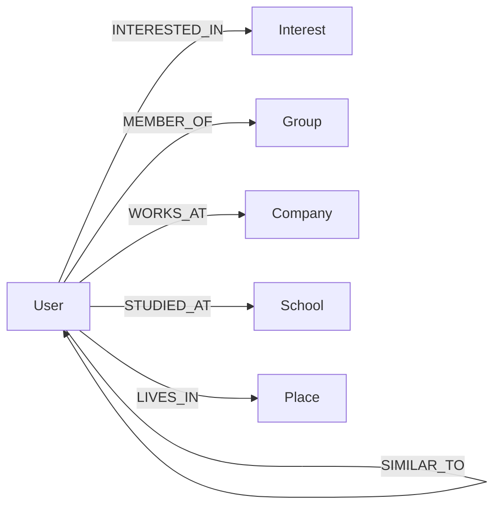

# 🌐 SocialCircle — Friend Recommendation System

> A full-stack social network powered by **Neo4j** graph database with a production-grade, multi-factor friend recommendation engine inspired by YouTube and LinkedIn's two-stage retrieval architecture.

---

## ✨ Features

| Feature | Description |
|---------|-------------|
| **Hybrid Recommender** | Weighted multi-factor scoring (structural, interest, community, geographic, recency) produces a 0–100 match score |
| **Cold-Start Fallback** | New users with zero friends still get meaningful suggestions |
| **Interactive Graph Explorer** | Force-directed ego-network visualization with 2-hop depth, showing friends, friends-of-friends, and recommended connections |
| **People Search** | Full-text Lucene index across names, usernames, and bios with prefix matching |
| **Friend Requests** | Send, accept, decline, and cancel friend requests |
| **Groups** | Join/leave groups, browse all groups, get group suggestions based on friends' memberships |
| **User Profiles** | Detailed profiles with interests, groups, mutual friends, and relationship status |
| **Dark / Light Theme** | User-togglable theme via `next-themes` |

---

## 🧠 Recommendation Algorithm

The recommender follows a **two-stage retrieval** pipeline:

### Stage 1 — Candidate Generation (cheap, bounded)

Five parallel sources, each capped to prevent a single hub/celebrity from exploding the frontier:

| Source | Strategy | Cap |
|--------|----------|-----|
| Friends-of-friends | Triadic closure, skip hubs with degree > 200 | 200 |
| Shared interests | Rank by overlapping interest count | 100 |
| Shared context | Same group, workplace, or school | 100 |
| GDS kNN neighbors | FastRP embedding similarity (if GDS is available) | all |
| Same city | Most recently active residents | 50 |

### Stage 2 — Feature Scoring (expensive, only on candidates)

Each candidate is scored across five normalized factors in \[0, 1\]:

$$
\text{matchScore} = 100 \times \bigl(0.40 \cdot S_{\text{structural}} + 0.25 \cdot S_{\text{interest}} + 0.15 \cdot S_{\text{community}} + 0.10 \cdot S_{\text{geo}} + 0.10 \cdot S_{\text{recency}}\bigr)
$$

| Factor | Method |
|--------|--------|
| **Structural** | Tie-weighted Adamic-Adar index with saturation transform |
| **Interest** | Weighted Jaccard over interest weights |
| **Community** | Shared groups + orgs + Louvain cluster + FastRP kNN similarity |
| **Geographic** | Exponential decay: $e^{-d/50}$ where *d* is distance in km |
| **Recency** | Half-life decay of tie freshness + candidate activity |

---

## 🗂️ Project Structure

```
friend-recommendation-neo4j/
├── backend/
│   ├── index.js                        # Express server entry point
│   ├── package.json
│   ├── .env                            # Neo4j connection config
│   ├── lib/
│   │   └── db.js                       # Neo4j driver singleton
│   └── src/
│       ├── routers/
│       │   ├── auth_router.js          # POST /api/auth/login
│       │   ├── friends_router.js       # GET/POST /api/friends/*
│       │   ├── groups_router.js        # GET/POST/DELETE /api/groups/*
│       │   ├── people_router.js        # GET /api/people/search, /api/people/:id
│       │   ├── profile_router.js       # GET/PUT /api/profile
│       │   └── graph_router.js         # GET /api/graph/ego
│       ├── controllers/
│       │   ├── auth_controller.js      # MERGE-based login (find or create)
│       │   ├── friends_controller.js   # Friend list, add/remove, hybrid recommender
│       │   ├── groups_controller.js    # Group CRUD + suggestions
│       │   ├── people_controller.js    # Full-text search + profile detail
│       │   ├── profile_controller.js   # Profile read/update
│       │   ├── graph_controller.js     # Ego-graph with recommendation overlay
│       │   └── requests_controller.js  # Friend request lifecycle
│       └── utils/
│           ├── cypher_loader.js        # Loads .cypher files from disk
│           ├── records.js              # Neo4j record → plain object helpers
│           ├── seeder.js               # Database seed script
│           ├── adapt_csv_data.js       # CSV data adapter
│           └── grow_network.js         # Network growth utility
├── cypher/
│   ├── 01_schema.cypher               # Constraints, indexes, full-text index
│   ├── 02_seed.cypher                 # Demo social network data
│   ├── 03_recommend_hybrid.cypher     # Multi-factor recommender query
│   └── 04_recommend_cold_start.cypher # Cold-start fallback query
├── frontend/
│   ├── index.html                     # Vite entry point
│   ├── vite.config.js
│   ├── package.json
│   └── src/
│       ├── main.jsx                   # App bootstrap with providers
│       ├── App.jsx                    # React Router with auth guards
│       ├── pages/
│       │   ├── login/                 # Username-based login
│       │   ├── friends/               # Friend list + suggestions
│       │   ├── groups/                # Group browse / join / leave
│       │   ├── profile/               # User profile editor
│       │   ├── people/                # People search directory
│       │   ├── person/                # Individual profile view
│       │   ├── explorer/              # Interactive graph visualization
│       │   └── test/                  # Dev testing page
│       ├── hooks/                     # Custom React hooks (auth, API)
│       ├── providers/                 # Theme + React Query providers
│       ├── layouts/                   # App shell layout
│       └── components/ui/             # shadcn/ui component library
└── *.py / *.pptx                      # Presentation build scripts
```

---

## 🏗️ Tech Stack

### Backend
- **Runtime:** Node.js (ES Modules)
- **Framework:** Express.js
- **Database:** Neo4j 5.x (Bolt protocol)
- **Driver:** `neo4j-driver` v5
- **Data Generation:** `@faker-js/faker`

### Frontend
- **Framework:** React 18 + Vite 6
- **Routing:** React Router v7
- **State Management:** Zustand
- **Data Fetching:** TanStack React Query
- **UI Components:** shadcn/ui (Radix UI primitives)
- **Styling:** Tailwind CSS
- **Charts:** Recharts
- **HTTP Client:** Axios
- **Theming:** next-themes

### Database Schema



**Node labels:** `User`, `Interest`, `Group`, `Company`, `School`, `Place`

**Key indexes:** Uniqueness constraints on all IDs/names, full-text Lucene index on `User(name, username, bio)`, geospatial POINT index on `Place(location)`, relationship-property index on `FRIENDS_WITH(lastInteraction)`

---

## 🚀 Getting Started & Setup Guide

### 📋 Prerequisites

- **Node.js** (v18 or higher)
- **npm** (comes with Node.js)
- **Neo4j** (v5.x or higher) — Desktop, Docker, or AuraDB

---

### 1️⃣ Neo4j Setup & Running

You can set up and run Neo4j using either **Neo4j Desktop** (recommended GUI) or **Docker** (quickest CLI).

#### Option A: Using Neo4j Desktop (GUI)
1. **Download & Install:** Download [Neo4j Desktop](https://neo4j.com/download/) and install it on your computer.
2. **Create Project & DBMS:**
   - Open Neo4j Desktop.
   - Click **New Project** (or select existing).
   - Click **Add** > **Local DBMS**.
   - Set DBMS Name (e.g. `SocialCircle`) and choose **Neo4j version 5.x** (e.g., `5.23+`).
   - Set a password (e.g. `your_password` or `jyothish`) and click **Create**.
3. **Install Plugins (Optional for GDS):**
   - Click on your DBMS > **Plugins** tab.
   - Install **Graph Data Science Library** (GDS) and **APOC** if prompted.
4. **Start the Database:**
   - Click the green **Start** button on your DBMS.
   - The database will start on `bolt://localhost:7687` and web UI on `http://localhost:7474`.

#### Option B: Using Docker (CLI)
Run a Neo4j 5.x container with a single command:

```bash
# Run Neo4j container with GDS plugin
docker run -d \
  --name socialcircle-neo4j \
  -p 7474:7474 -p 7687:7687 \
  -e NEO4J_AUTH=neo4j/your_password \
  -e NEO4J_PLUGINS='["graph-data-science"]' \
  neo4j:5-community
```

To manage the Neo4j container later:
```bash
docker start socialcircle-neo4j   # Start Neo4j
docker stop socialcircle-neo4j    # Stop Neo4j
```

> 🌐 **Verify Neo4j is running:** Open [http://localhost:7474](http://localhost:7474) in your browser. Connect with username `neo4j` and your configured password.

---

### 2️⃣ Clone Repository & Setup Environment

```bash
git clone https://github.com/Jyothish-B/SocialCircle.git
cd SocialCircle
```

Configure your Neo4j connection in `backend/.env`:

```env
NEO4J_URI=bolt://localhost:7687
NEO4J_USERNAME=neo4j
NEO4J_PASSWORD=your_password
NEO4J_DATABASE=neo4j
PORT=3000
```
*(Make sure `NEO4J_PASSWORD` matches the password set during Neo4j setup)*

---

### 3️⃣ Install Dependencies

Open a terminal and install dependencies for both backend and frontend:

```bash
# 1. Install Backend Dependencies
cd backend
npm install

# 2. Install Frontend Dependencies
cd ../frontend
npm install
```

---

### 4️⃣ Seed Database with Sample Social Network

Run the seeder from the `backend` folder to set up schema, uniqueness constraints, indexes, and sample users/connections:

```bash
cd backend

# Basic seed (schema + demo network)
npm run seed

# If database already has data and you want to wipe & reseed:
npm run seed -- --force

# If you installed Neo4j GDS plugin and want community detection/embeddings:
npm run seed -- --gds
```

---

### 5️⃣ Running the Application

To run the application, start both the backend server and frontend client in separate terminal windows:

#### Terminal 1: Start Backend Server
```bash
cd backend
npm run dev
```
> Server will start at: **http://localhost:3000**

#### Terminal 2: Start Frontend App
```bash
cd frontend
npm run dev
```
> Web application will start at: **http://localhost:5173**

---

### 6️⃣ Access the App

1. Open your browser and go to **http://localhost:5173**.
2. On the login screen, enter any username (e.g., `jyothish` or `alice`).
3. If the user doesn't exist, an account is created automatically, and you will be directed to your dashboard!

---

---

## 📡 API Reference

| Method | Endpoint | Description |
|--------|----------|-------------|
| `POST` | `/api/auth/login` | Login / register by username |
| `GET` | `/api/friends?user_id=` | List user's friends |
| `GET` | `/api/friends/suggested?user_id=` | Get friend recommendations |
| `POST` | `/api/friends/add` | Add a friend |
| `POST` | `/api/friends/remove` | Remove a friend |
| `POST` | `/api/friends/request` | Send friend request |
| `GET` | `/api/friends/requests?user_id=` | Get pending requests |
| `POST` | `/api/friends/requests/accept` | Accept a request |
| `POST` | `/api/friends/requests/decline` | Decline a request |
| `POST` | `/api/friends/requests/cancel` | Cancel sent request |
| `GET` | `/api/people/search?viewer_id=&q=` | Full-text people search |
| `GET` | `/api/people/:id?viewer_id=` | Get person's detailed profile |
| `GET` | `/api/groups?user_id=` | Get user's groups |
| `GET` | `/api/groups/all?user_id=` | Browse all groups |
| `GET` | `/api/groups/my-groups?user_id=` | User's joined groups |
| `GET` | `/api/groups/suggested?user_id=` | Group suggestions |
| `POST` | `/api/groups/join` | Join a group |
| `DELETE` | `/api/groups/quit` | Leave a group |
| `GET` | `/api/profile?user_id=` | Get profile |
| `PUT` | `/api/profile` | Update profile |
| `GET` | `/api/graph/ego?viewer_id=&center_id=&depth=` | Ego-network graph data |

---

## 🔑 Key Cypher Queries

<details>
<summary><b>Schema & Indexes</b> — <code>01_schema.cypher</code></summary>

Creates uniqueness constraints on all node IDs, secondary indexes for `lastActiveAt`, `communityId`, interest `category`, geospatial `Place.location`, relationship property `FRIENDS_WITH.lastInteraction`, and a full-text Lucene index for people search.
</details>

<details>
<summary><b>Hybrid Recommender</b> — <code>03_recommend_hybrid.cypher</code></summary>

164-line single Cypher query implementing the two-stage retrieval pipeline. Uses scoped `CALL` subqueries (Neo4j ≥ 5.23), pattern comprehensions, and `reduce()` for in-query feature engineering. No stored procedures required.
</details>

---

## 🛠️ Utility Scripts

| Script | Command | Description |
|--------|---------|-------------|
| Seed | `npm run seed` | Load schema + demo network |
| Adapt CSV | `npm run adapt` | Import external CSV data |
| Grow Network | `npm run grow` | Synthetically expand the social graph |

---

## 📄 License

ISC

---

<p align="center">
  Built with ❤️ using Neo4j, React, and Express
</p>
